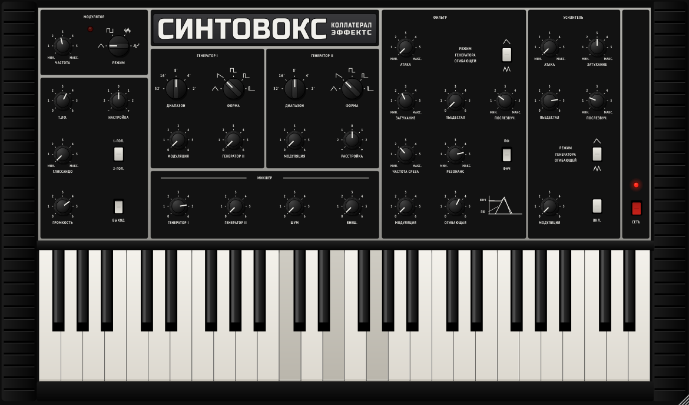

# Volks82 — emulazione del Polivoks (VST3 / AU / Standalone)

Plugin strumento in C++17 con JUCE 8, marchio **Collateral Effects**. Riproduce il sintetizzatore
duofonico sovietico Polivoks (Formanta, 1982) seguendo il manuale d'uso e gli schemi elettrici
originali (blocchi У1–У9).



## Architettura (dagli schemi)

| Blocco originale | Emulazione |
|---|---|
| **У1 Tastiera** — 4 ottave Fa–Mi, 1-ГОЛ./2-ГОЛ. | Duofonia: Gen I prende la nota più bassa, Gen II la più alta. In 1 voce entrambi suonano la più bassa. Impulso di avvio a ogni cambio di tensione; la tensione resta tenuta dopo il rilascio (FET KП303). Glissando RC solo sul Gen I. |
| **У2/У3 Generatori** | Nucleo esponenziale a dente di sega (0…+10 V); triangolo dal raddrizzatore di precisione A9 (0…−5 V, quindi 6 dB più basso della sega); impulsi dal comparatore A10 in tre larghezze (~±2 V). Gamme 32'…2': il Fa più basso a 32' è 21.8 Hz, il Mi più alto a 2' è 5274 Hz, come da specifiche, con il leggero calo delle note acute dovuto al tempo di scarica. НАСТРОЙКА ±1 tono, РАССТРОЙКА ±2 toni (±25 %). FM esponenziale del Gen I dal Gen II. Deriva lenta (±0.5 % / 4 h nell'originale). |
| **У7 Modulatore** | Trigger di Schmitt A5 (soglie ±1,5 V) che carica C7 da 10 µF: 0,2 … ~40 Hz. Triangolo ±1,5 V; **quadra solo positiva** (0…+1,5 V, sposta verso l'alto); impulsi caotici (comparatore su rumore filtrato 82k/10 nF); gradini casuali (sample & hold FET + 0.22 µF a ogni periodo). Il LED lampeggia con la quadra. |
| **У6 Mixer** | Sommatore invertente 22k/22k con i potenziometri da 100 kΩ caricati (curva risultante quasi logaritmica); ingresso esterno (ВНЕШ.). |
| **У4 Filtro** | Due K140UD12 come integratori a transconduttanza: A2 riceve l'errore diviso per 48 (47k/1k) e satura quando la risonanza cresce, A3 riceve l'uscita di A2 divisa per 48. La corrente di polarizzazione viene da A1+V1, quindi **la frequenza di taglio è lineare in Hz**: manopola, inviluppo, modulatore e pedale si sommano, e il modulatore può chiudere del tutto il filtro alle frequenze basse. La risonanza è il partitore R89+R54 sull'uscita passa-banda: al minimo Q≈1, al massimo autooscillazione. ФНЧ (premuto) / ПФ (rilasciato); taglio a zero = nessun suono. |
| **У5 Amplificatore** | Due VCA a coppia differenziale K118UD1 in serie (modulazione e inviluppo) con ingressi divisi per 100: schiacciano i picchi risonanti forti. Inviluppi: condensatore da 5 µF caricato verso +12,5 V e commutato a +6 V, potenziometri da 1 MΩ logaritmici (attacco ~0,7 ms … 3,3 s; decadimento del filtro da ~22 ms). Modo ripetuto (∧∧) con ПЬЕДЕСТАЛ basso, come nel manuale. ВКЛ. tiene l'amplificatore aperto sull'ultima nota. |
| **Uscite** | ВЫХОД premuto = uscita di linea (ГРОМКОСТЬ); rilasciato = uscita cuffia (Т.ЛФ., finale KT815/KT814). СЕТЬ accende e spegne. |

Il motore gira a ~88–96 kHz (qualità normale) o ~176–192 kHz (alta, dal menu del logo).
Quando non suona nessuna nota il motore resta fermo e non consuma CPU; mentre suona usa meno
dell'1 % di un core in qualità normale.

## Taratura sulle registrazioni dell'originale

Le forme d'onda sono confrontate con note singole registrate da un Polivoks (sega, quadra e
impulso, da Do0 a Do7) con `tests/render_notes.cpp`, che rende le stesse note col filtro aperto:

- **Cicli utili:** quadra 46,6 %, impulso 19,8 %; il comparatore allunga lo stato alto di ~13 µs,
  per cui in acuto crescono (Do6: 49,8 % e 22,6 %), come nelle registrazioni.
- **Ampiezze:** sega, quadra e impulso hanno quasi lo stesso picco-picco (quadra e impulso ~0,8
  della sega).
- **Risposta dei generatori:** dopo ogni fronte un piccolo superamento (~12 %, τ ≈ 0,23 ms) e,
  sopra ~3 kHz, una discesa a mensola fino a circa −11 dB; accoppiamento in AC a ~12 Hz.
- **Intonazione:** entro ±4 cent da Do0 a Do7.

Le armoniche rese differiscono da quelle registrate di 0,2–1 dB (sotto i 10 kHz). Il triangolo e
l'impulso stretto non sono nelle registrazioni e restano ricavati dagli schemi.

## Uso con la tastiera MIDI (Arturia KeyLab)

- **Clic destro** su qualunque manopola o tasto → *MIDI Learn*, poi muovi un controllo della KeyLab.
  Le assegnazioni si salvano con il progetto.
- Assegnazioni predefinite: CC 74 taglio, CC 71 risonanza, CC 11 (pedale d'espressione) pedale
  del filtro, CC 7 volume, CC 5 glissando, CC 64 sustain (tiene i tasti).
- **Clic sul riquadro del logo**: pitch bend (non presente sull'originale, predefinito 2 semitoni),
  quantità di deriva analogica, qualità audio, ripristino delle assegnazioni MIDI.
- La tastiera a schermo copre le 4 ottave originali (Fa–Mi); dalla KeyLab arrivano tutte le note.
- I selettori (ДИАПАЗОН, ФОРМА, РЕЖИМ) si girano trascinando o con la rotellina.

## Compilazione

La build macOS (universale Apple Silicon + Intel) la fa GitHub Actions a ogni push su `main`:
l'archivio `Volks82-macOS` compare tra gli artefatti dell'esecuzione. Con un tag `v*`
(es. `v1.0.0`) viene creata anche una Release pubblica. Dentro c'è `Installa Volks82.command`, che
copia i plugin in `/Library/Audio/Plug-Ins/VST3` e `/Library/Audio/Plug-Ins/Components` e l'app in
`/Applicazioni`.

In locale:

```
cmake -B build -DCMAKE_BUILD_TYPE=Release
cmake --build build --target Volks82_VST3 Volks82_AU Volks82_Standalone
```

Test del motore: `c++ -O2 -std=c++17 tests/engine_test.cpp -o engine_test && ./engine_test`
(intonazione, estensione 21.8 Hz–5274 Hz, autooscillazione, stabilità, CPU).

## Crediti

Font PT Sans / PT Sans Narrow (ParaType) e Russo One (Jovanny Lemonad) per il logo, tutti con SIL Open Font License (vedi `resources/fonts`).
Polivoks è un nome storico della Formanta; questo progetto non è affiliato ai produttori originali.
